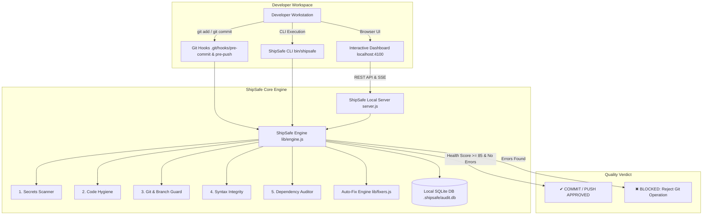

# 🛡️ ShipSafe — Autonomous Local Pre-Flight Code Quality Gate

> **Catch security vulnerabilities, syntax errors, and fatal code smells on your local machine *before* they ever reach GitHub or break production CI.**

---

## 🎨 System Architecture Illustration (Ian Xiaohei English Edition)


> 📌 **Mandatory Maintenance Rule**: Whenever code is pushed, modified, or architectural features are updated in this repository, this hand-drawn Ian Xiaohei architectural illustration (`assets/shipsafe-architecture.svg`) must be updated to maintain 100% sync with the live system.

---

### 🗺️ Visual Walkthrough: How ShipSafe Protects Your Pipeline

The illustration above maps the end-to-end lifecycle of every line of code written in this repository:

1. **Local Staging Buffer (Left)**
   * As the developer stages code (`git add .`), ShipSafe hooks into the local Git staging buffer (`git diff --cached`).
   * Potential hazards like raw `.env.production` files, exposed AWS API keys (`AKIA...`), unpinned dependencies, or stray `debugger;` breakpoints are caught immediately before they are baked into Git commit objects.

2. **The Pre-Flight Gatehouse & Radar (Center)**
   * Operated by **Xiaohei** (the diligent guardian with optical inspection tools and an engineer headset), the pre-flight engine evaluates staged files against **5 multi-stage quality gates** in under **50ms**:
     * 🛡️ **Gate 1: Secrets & Credentials**: High-precision entropy & pattern scanner for AWS, Stripe, GitHub PATs, JWTs, and database URIs.
     * 🧹 **Gate 2: Code Hygiene**: Scans for `debugger;`, stray `console.log()` calls, and `TODO [BLOCKER]` markers.
     * 🌿 **Gate 3: Git Guard & Branch Policy**: Blocks direct commits to `main`/`master`, blocks large binary bloat (>1MB), and arrests `.env` leaks.
     * 🔍 **Gate 4: Syntax & ESM Integrity**: Real-time non-executing AST validation (`node --check`, `JSON.parse`).
     * 📦 **Gate 5: Dependencies & Lockfiles**: Enforces `package-lock.json` sync whenever `package.json` changes and flags wildcard dependencies (`*`, `latest`).
   * **Persistence**: Every run, health score (0–100), and latency metric is logged locally into `.shipsafe/audit.db` using Node 26's native `node:sqlite`.
   * **Live Stream**: The background daemon continuously broadcasts Git staging state changes via Server-Sent Events (SSE) to the local dashboard at `http://localhost:4100`.

3. **The Divert & Auto-Fix Quarantine (Top Right — Red & Orange Accents)**
   * If any critical error is detected, the Git hook **blocks the operation immediately with Exit Code 1**.
   * Dangerous files are diverted into a quarantine state.
   * Developers can run `npm run fix` (or click **"⚡ Auto-Fix"** in the web UI) to automatically unstage sensitive files, remove `debugger;` statements, and format malformed YAML/JSON.

4. **The Verified Release Stream (Bottom Right — Blue & Green Accents)**
   * Code scoring 85–100 with zero critical errors is approved with Exit Code 0.
   * Commits cleanly travel to **GitHub / Production CI**, guaranteeing that remote CI pipelines won't fail on avoidable local defects.

---

## 🏗️ Defined Tech Stack

Built to be **fast**, **zero-bloat**, and **completely independent** of external cloud APIs or third-party SaaS vendors:

| Layer | Technology | Rationale & Capabilities |
| :--- | :--- | :--- |
| **Runtime & Core Engine** | **Node.js (v26 LTS)** | Native ES Modules, ultra-low startup overhead (<15ms), zero required external npm dependencies for core scanning. |
| **Local Persistence** | **Embedded `node:sqlite`** | ACID-compliant synchronous SQLite database (`.shipsafe/audit.db`) storing all pre-flight runs, health scores, and audit metrics. |
| **API & Real-time Sync** | **Native HTTP + Server-Sent Events (SSE)** | High-throughput local REST API with continuous background Git watcher that pushes real-time updates as soon as files are staged. |
| **Static & Rule Engine** | **Multi-stage Heuristic & AST Scanner** | High-precision regex entropy analyzers, syntax compilers (`node --check`, `JSON.parse`), file payload analyzers, and Git plumbing commands (`git diff`, `git rev-parse`). |
| **User Interface** | **Reactive Single-Page Dashboard** | Cyber-clean dark theme UI featuring SVG Health Radar gauge, Category Health matrix, Unified Diff viewer, and 1-Click Auto-Fix actions. |
| **Git Integration** | **POSIX Git Hooks (`pre-commit`, `pre-push`)** | Native shell hooks that communicate with the local engine to reject non-compliant commits before they enter Git history. |

---

## 📐 Architecture Diagram



---

## 🚀 Quick Start Guide

### 1. Install & Verify
```bash
# Clone or navigate into your repository
cd /path/to/your/project

# Install automated Git pre-commit and pre-push hooks
npm run install-hooks
# or: node bin/shipsafe install-hooks
```

### 2. Run Terminal Pre-Flight Check
```bash
# Check currently staged files
npm run check

# Check all tracked files across repository
npm run check:all
```

### 3. Launch Local Interactive Dashboard
```bash
npm start
# or: node bin/shipsafe serve --port=4100
```
Open **[http://localhost:4100](http://localhost:4100)** to view your real-time Code Health Radar, Category Matrix, Diff Inspector, and 1-Click Auto-Fixes.

---

## 🔍 Health Check Rule Matrix

### 1. 🛡️ Secrets & Credentials Scanner (`lib/rules/secrets.js`)
* **AWS Credentials**: Flags unrotated `AKIA...` access key IDs and secret keys.
* **GitHub PATs**: Detects modern `ghp_` tokens and fine-grained `github_pat_` tokens.
* **Payment Gateways**: Identifies live Stripe keys (`sk_live_`, `rk_live_`).
* **Private Cryptographic Keys**: Detects RSA, EC, OpenSSH, and PGP private keys.
* **Auth Tokens**: Flags long-lived JWT tokens and Slack bot / webhook tokens.
* **Database URIs**: Blocks connection strings containing plaintext credentials.
* *Zero False-Positive Filter*: Intelligently ignores test mocks and placeholder strings (`dummy`, `example`, `replace_me`, `user:pass`).

### 2. 🧹 Code Hygiene & Smells (`lib/rules/hygiene.js`)
* **Debuggers**: Flags `debugger;`, `breakpoint()`, and Python `pdb.set_trace()`. *(Auto-Fixable)*
* **Console Dumps**: Detects leftover `console.log`, `console.debug`, and `console.trace`. *(Auto-Fixable)*
* **Blocker Markers**: Blocks `TODO [BLOCKER]`, `FIXME [CRITICAL]`, and `DO_NOT_COMMIT`.
* **Linter Bypasses**: Flags suppression hacks like `@ts-ignore` and `eslint-disable`.
* **Hardcoded Localhost**: Warns on hardcoded `http://localhost:...` endpoints destined for production.

### 3. 🌿 Git Guard & Repo Hygiene (`lib/rules/git-guard.js`)
* **Protected Branch Policy**: Blocks direct commits or pushes to `main`, `master`, `production`, or `release/*`.
* **Staged Credentials / .env**: Automatically detects staged `.env`, `.env.local`, or `.pem` files. *(Auto-Fixable via 1-click unstage)*
* **File Bloat / Binaries**: Prevents staging files larger than 1MB (configurable) or database files (`.sqlite`, `.db`, `.dump`).
* **OS Clutter**: Prevents commits containing `.DS_Store` or `Thumbs.db`.

### 4. 🔍 Syntax & Integrity (`lib/rules/syntax.js`)
* **JSON Syntax Validator**: Verifies valid JSON structure with exact line and column error reporting.
* **JavaScript / ESM Syntax Compiler**: Validates syntax across CommonJS and ES Modules via non-executing AST validation (`node --check`).
* **YAML Tab Prohibition**: Detects and fixes forbidden tab indentation in YAML files. *(Auto-Fixable)*

### 5. 📦 Dependencies & Lockfiles (`lib/rules/dependencies.js`)
* **Lockfile Desync Gate**: Prevents staging `package.json` modifications without also staging the updated lockfile (`package-lock.json`, `pnpm-lock.yaml`, `yarn.lock`).
* **Unpinned Wildcards**: Flags non-deterministic version wildcards (`*`, `latest`, `>=`).

---

## ⚡ 1-Click Auto-Remediation

ShipSafe doesn't just complain about issues—it can repair them automatically:

```bash
# Auto-fix all remediable issues from the terminal
npm run fix
```

Or click **"⚡ Auto-Fix"** directly inside the web dashboard to:
* Remove leftover `debugger;` breakpoints from source files.
* Comment out stray `console.log()` statements.
* Unstage sensitive `.env` or large binary files (`git reset HEAD <file>`).
* Replace disallowed tabs with spaces in YAML manifests.

---

## ⚙️ Configuration Reference

ShipSafe is customizable via `.shipsafe/config.json`:

```json
{
  "version": "1.0.0",
  "port": 4100,
  "host": "127.0.0.1",
  "scoreThresholds": {
    "pass": 85,
    "warn": 70
  },
  "rules": {
    "secrets/credentials": { "enabled": true, "severity": "ERROR" },
    "git/branch-protection": {
      "enabled": true,
      "severity": "ERROR",
      "protectedBranches": ["main", "master", "production"]
    },
    "git/large-files": {
      "enabled": true,
      "severity": "ERROR",
      "maxSizeBytes": 1048576
    },
    "hygiene/debuggers": { "enabled": true, "severity": "ERROR" },
    "hygiene/console-logs": { "enabled": true, "severity": "WARN" },
    "deps/lockfile-sync": { "enabled": true, "severity": "ERROR" }
  },
  "ignoredPaths": [
    "node_modules/",
    ".git/",
    "dist/",
    "build/",
    "coverage/"
  ]
}
```

---

## 🎨 Ian Xiaohei Illustration Skill Reference

This repository includes the English edition of the **Ian Xiaohei Illustration Skill** installed under `.agents/skills/ian-xiaohei-illustrations-en/`:
* `SKILL.md`: Main execution guide for generating technical and editorial illustrations.
* `references/style-dna.md`: 16:9 widescreen rules, pure white background, black ink line art, and sparse red/orange/blue accents.
* `references/xiaohei-ip.md`: Anatomy and personality traits of the Xiaohei protagonist.
* `references/composition-patterns.md`: Composition patterns for system flows, filters, checkpoints, and before/after views.
* `references/prompt-template.md`: Image generation prompt assembly structure.
* `references/qa-checklist.md`: Visual QA checklist to enforce compliance before publishing.

---

## 🧪 Testing

ShipSafe includes an automated test suite executed via Node's native test runner:

```bash
npm test
```

All rules, fixers, and SQLite schema migrations are validated in under **5ms**.

---

## 🛡️ License

MIT License. Designed and crafted for high-velocity software engineering teams.
