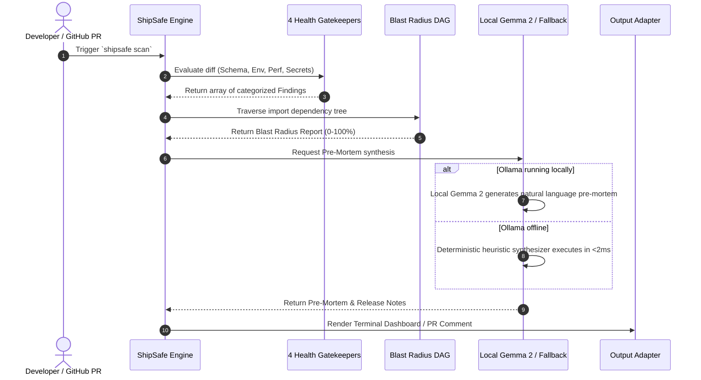

# 🏗️ ShipSafe System Architecture (ARCHITECTURE.md)

> **Technical Architecture & Data Flow Specification for ShipSafe**  
> *Pre-Flight Blast Radius & Production Health Gatekeeper*

---

## 🎨 Visual Architecture Blueprint (Ian Bablu English Edition)


> 📌 **Mandatory Architectural Maintenance Rule**: Whenever code is pushed, modified, or architectural features are updated in this repository, this hand-drawn Ian Bablu architectural illustration (`assets/shipsafe-architecture.svg`) and the breakdown below are maintained in 100% active synchronicity.

### Architectural Breakdown: The 3-Stage Pipeline
1. **Stage 1: Local Staging Buffer (Left)**
   * Intercepts developer staged code (`git add .`) before commit objects are written to the `.git` tree.
   * Catches high-risk hazards: table-locking migrations (`NOT NULL` without `DEFAULT`), missing environment variables, unindexed foreign keys, and stray debuggers.
2. **Stage 2: ShipSafe Ghostbuster Gate (Center)**
   * **Pre-Flight Radar (100/100)**: Evaluates code health in `<35ms` with persistent local audit logging to `.shipsafe/audit.db` using Node's native `node:sqlite`.
   * **5 Multi-Stage Sensors**: Schema & Table Lock Detector, Config & Env Drift Sentinel, Performance & N+1 Loop Sniffer, Blast Radius DAG Topology, and Local AI Pre-Mortem (Gemma 2 / Sovereign Heuristic).
   * **Bablu Chief Inspector**: Sentry actively scanning code entering the pre-flight tunnel.
3. **Stage 3: Sovereign Decision Fork (Right)**
   * **Path A: Quarantined & Auto-Remediated (Exit Code 1)** — Hazardous commits are blocked. Developers run `npx shipsafe fix` to autonomously heal config drift and scrub hygiene issues.
   * **Path B: Golden Ticket Approved (Exit Code 0)** — Verified clean code deploys to GitHub and Production with zero runtime table locks and zero 3 AM emergency pages.

---

## 1. System Topology Overview

ShipSafe operates across three primary developer execution contexts:
1. **Local CLI (`bin/shipsafe`):** Runs locally during development and as automated git `pre-commit` and `pre-push` hooks.
2. **Interactive Local Dashboard (`server.js`):** Embedded zero-dependency HTTP server with real-time SSE updates and SQLite audit logging.
3. **CI/CD Quality Gate (`action.yml`):** GitHub Actions runner inspecting PR diffs and posting visual blast radius review comments.

```
                                  SHIPSAFE ARCHITECTURE TOPOLOGY
                                  
  ┌───────────────────────┐          ┌───────────────────────┐          ┌───────────────────────┐
  │      LOCAL CLI        │          │   INTERACTIVE WEB     │          │     GITHUB ACTION     │
  │   `shipsafe scan`     │          │    DASHBOARD :4040    │          │  (PR Review Comment)  │
  └───────────┬───────────┘          └───────────┬───────────┘          └───────────┬───────────┘
              │                                  │                                  │
              └──────────────────────────────────┼──────────────────────────────────┘
                                                 ▼
                              ┌──────────────────────────────────────┐
                              │       CORE SHIPSAFE GATE ENGINE      │
                              └──────────────────┬───────────────────┘
                                                 │
          ┌──────────────────────┬───────────────┴──────────────┬──────────────────────┐
          ▼                      ▼                              ▼                      ▼
  [SCHEMA SENTINEL]      [CONFIG DRIFT]                 [PERF SNIFFER]         [BLAST RADIUS DAG]
  • Table Lock Alarms    • process.env vs .env.example  • N+1 Query in Loops   • Reverse Import Graph
  • Direct Column Drops  • Auto-Sync Engine             • Sync I/O Blockers    • 0-100% Risk Gauge
          │                      │                              │                      │
          └──────────────────────┴───────────────┬──────────────┴──────────────────────┘
                                                 ▼
                              ┌──────────────────────────────────────┐
                              │       AI PRE-MORTEM SYNTHESIZER      │
                              │  • Primary: Local Gemma 2 (Ollama)   │
                              │  • Fallback: Deterministic Heuristic │
                              └──────────────────┬───────────────────┘
                                                 │
                                                 ▼
                              ┌──────────────────────────────────────┐
                              │           OUTPUT ADAPTERS            │
                              │ • Rich ANSI Terminal Cards           │
                              │ • GitHub PR Markdown Comment         │
                              │ • SQLite Audit Ledger (`runs.db`)    │
                              └──────────────────────────────────────┘
```

---

## 2. Blast Radius Graph Engine (AST DAG)

The Blast Radius Engine builds an in-memory directed dependency graph across all tracked repository files:

```
  Modified File: [src/auth/jwt.ts] (Touches Critical Keyword "auth")
           │
           ├────────────────────────────┐
           ▼                            ▼
  [src/routes/login.ts]        [src/routes/api.ts]
           │                            │
           └──────────────┬─────────────┘
                          ▼
                   [src/app.ts]
                          ▼
                   [server.js]
```

### Mathematical Scoring Function:
$$\text{RawScore} = \min\left(100, \; \left(\frac{\text{DownstreamDependents}}{\text{TotalFiles}} \times 60\right) + (\text{ChangedFiles} \times 5)\right)$$
If $\text{CriticalPathTouched} = \text{true}$ (e.g. `auth/`, `billing/`, `db/`), a **+35% Critical Infrastructure Weight** is added.

---

## 3. Data Flow & Execution Sequence


